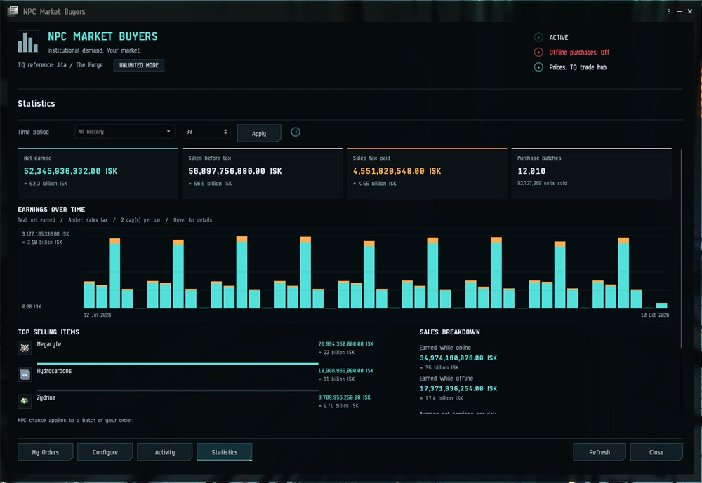
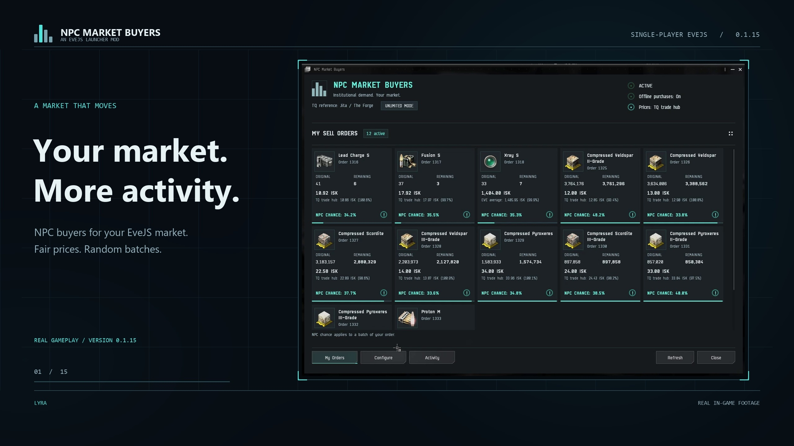

# NPC Market Buyers

**Give your single-player EveJS market someone to sell to.**

[](https://github.com/V0nCleef/EveJS-NPC-Market-Buyers/actions/workflows/checks.yml)
[](LICENSE)
[](#requirements)

NPC institutions buy your sell orders in sensible, randomised batches. Prices are checked against Tranquility trade hubs, with EVE average and local NPC buy offers available as fallbacks. Advice appears directly in the normal Sell Items window.

[Releases](https://github.com/V0nCleef/EveJS-NPC-Market-Buyers/releases) · [Feature guide](docs/FEATURES.md) · [Changelog](CHANGELOG.md) · [Report an issue](https://github.com/V0nCleef/EveJS-NPC-Market-Buyers/issues)

**Version 0.1.16 is available.** Active-order totals, archived Activity and the new Statistics page have been tested in an isolated EVE client and approved by the maintainer.



*Actual in-game screenshot using invented test history. Your own sales appear after updating.*

[](https://github.com/V0nCleef/EveJS-NPC-Market-Buyers/releases/download/v0.1.15/NPC-Market-Buyers-Showcase-0.1.15.mp4)

[Watch the original 2-minute showcase](https://github.com/V0nCleef/EveJS-NPC-Market-Buyers/releases/download/v0.1.15/NPC-Market-Buyers-Showcase-0.1.15.mp4) · [Download 0.1.16](https://github.com/V0nCleef/EveJS-NPC-Market-Buyers/releases/tag/v0.1.16)

## What it does

- **Sell advice where you need it.** See the reference price, fairness warnings, buying chance and possible batch size while placing an order.
- **Randomised purchases.** Small batches are more common, with occasional larger purchases. A successful buying check does not automatically clear a huge order.
- **A native in-game dashboard.** My Orders and Activity offer Icons, Details and List views. Original and remaining quantities stay visible. Bars start full and drain as stock sells.
- **Active-order totals.** See actual NPC sales, remaining stock value and their combined total beside My Sell Orders.
- **Sales statistics.** Graphs, sales tax, net earnings and top selling items cover all history or a custom number of days. Archived sales still count.
- **Manageable history.** Recent Activity keeps up to 500 entries from the last 30 days; older entries stay in the Archive. Both load 100 entries per page.
- **Wallet-style amounts.** Exact ISK values have readable thousand, million, billion and trillion descriptions using the client's language.
- **Clear configuration.** Context-sensitive settings, help popups, hub/region dropdowns and a small reset button beside each field.
- **Optional offline buying.** Resume missed checks after restarting the stack, with individual sales in Activity and bundled income in the Wallet.
- **Readable Wallet descriptions.** New online sales identify the item, quantity, unit price, gross income, tax and net income.
- **Eight languages.** English, German, French, Spanish, Russian, Chinese, Japanese and Korean follow the active client language.

## Requirements

| Component | Reviewed compatibility |
|---|---|
| EveJS | **0.12.9** |
| Launcher | **1.0.69 or newer**, with the shared Mods menu |
| EVE client | Build **3396210** |
| Backend | **Native Windows** |

The installer validates the reviewed native file hashes. Other EveJS builds or modified native market files can be refused. Docker is not supported by this release.

## Install

1. Download **NPC-Market-Buyers-0.1.16.zip** from the [release's Assets](https://github.com/V0nCleef/EveJS-NPC-Market-Buyers/releases/tag/v0.1.16).
2. Stop EveJS and the native market in the Launcher, and close EVE.
3. Open **Launcher → Mods → Add ZIP**, select the package and install/enable it.
4. Start the stack and reconnect EVE.
5. Open **Mods → NPC Market Buyers** in game. Use the ordinary **Sell Items** window for price advice.

Use the attached Launcher ZIP. GitHub's automatic **Source code** downloads are development archives and cannot be imported as this mod.

When updating, disable/remove the old package before importing the new one, and keep only one version enabled. Settings and purchase history live outside the replaceable mod folder. Back up your server data before installing or updating mods.

On the first start after updating, existing completed purchase receipts are added to Statistics once. This does not make new payments or change your orders. Archived sales remain included in totals.

## Pick your buying mode

| Mode | What it means |
|---|---|
| **Unlimited** — default | NPCs can consider any eligible item at a fair price. No daily budgets or item-volume quotas. |
| **Limited** | The same price checks and buying chances, with configurable spending caps and TQ volume quotas. Only relevant settings appear. |

Unlimited does not guarantee a purchase. By default, an order at the reference price has a **35% chance per fixed 15-minute check**. Successful checks buy a random **0.01%–10% of the remaining grouped stock**, rounded to whole units, with at least one unit when eligible. Above the default **125% price ceiling**, NPCs do not buy.

## Price references

The default is **TQ trade hub**, starting with Jita / The Forge. Region and station dropdowns select the other curated hubs. The reference uses the cheapest 5% of available station sell depth; one valid order is enough.

If a hub price is missing or rejected as unrealistic, the mod tries CCP's EVE average price, then an eligible local seeded NPC buy offer using the native immediate-sell rules. EVE average can also be selected directly: it is EVE Online's overall average, rather than your local EveJS market. The UI names the source actually used. If all sources fail, the item pauses with a clear explanation rather than inventing a fair price.

Public ESI requests need no account login or API key. See the [feature guide](docs/FEATURES.md#tq-connection) for the endpoints, caching and fallback details.

## Offline purchases

Offline buying is **off by default**. Enable it in Configure, or click its status indicator to jump to that setting. Missed checks resume gradually against current prices and currently valid orders.

Wallet income is bundled per wallet/division instead of producing dozens of catch-up popups. Activity retains each item sale. Activity times are simulated within the missed intervals; actual settlement timestamps and native financial receipts remain authoritative. Historical market prices are not reconstructed.

## Development and validation

```sh
npm test
python tools/check_source.py
```

Use Node.js 22+ and Python 3.12. These portable checks need no server or npm dependencies. Native and client contracts require your own local installation/reference files; see [Development](docs/DEVELOPMENT.md).

[VERIFICATION.md](VERIFICATION.md) records the latest checks and their limits. Isolated checks are separate from live rendering and gameplay approval. The native market source and reviewed payload are included; see [Attribution](NOTICE.md) and [LICENSE](LICENSE).
